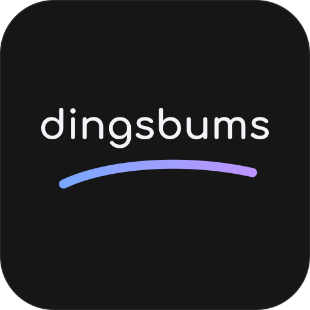
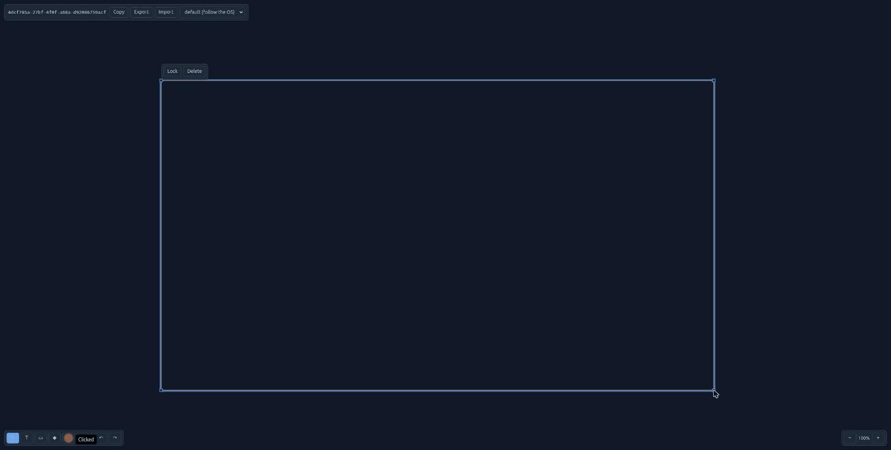

  

<h1 align="center">dingsbums</h1>

  A digital collaboration whiteboard: open a session, share its link, and draw
  together in real time.

  <a href="#features">Features</a>
  &nbsp;·&nbsp;
  <a href="#installation">Installation</a>
  &nbsp;·&nbsp;
  <a href="#development">Development</a>
  &nbsp;·&nbsp;
  <a href="docs/superpowers/specs/2026-10-06-whiteboard-design.md">Design</a>
  &nbsp;·&nbsp;
  <a href="#tools-used">Tools used</a>

---

No accounts, no setup: create a session and send the link (`/#<session-id>`)
to whoever should join. Everyone on it edits the same board live.

## Why the name

*Dingsbums* is German for "thingamajig": the word for a thing whose name you
can't think of right now. That's what a whiteboard is full of.

## Features

- Frames, sticky notes, text, shapes (circle, rectangle, star, arrow) and
  connections between them.
- Fill and text colours, groups, locking, undo/redo.
- Layering: bring a selection (or group) to the front, forward, backward or
  to the back from the toolbar above it; Home and End for front and back.
- Paste images and text straight onto the board.
- Copy and paste (Ctrl+C, Ctrl+V) whatever is selected, images included, also
  into another board: the copies keep their layout and the connections
  between them, and land beside the originals or in the middle of the view.
  A single copied image also pastes as a picture into other apps (on https or
  localhost; elsewhere the browser keeps copies within dingsbums).
- An infinite canvas: scroll to pan (shift + wheel sideways), ctrl + wheel or
  the + and − buttons to zoom.
- Hand mode (the hand beside the zoom, or H) for a mouse: drag the empty canvas to
  pan, the wheel zooms, Shift- or Ctrl-drag draws a selection box (Shift adds
  to the selection). This browser remembers it.
- Keys for the tools: V select, T text, F frame, S shapes (again: the next
  shape), N sticky note, L connection. Picking the active tool again, by key
  or button, goes back to Select; a hint at the bottom says what to do.
- Export a board as a `.tar` and import it again.
- A quiet parchment look by default, twelve more colour themes, or follow
  the OS light/dark setting. Themes only change the colours.

Sessions live in the server's memory. A session nobody has open for 15
minutes is gone, so export what you want to keep.

## Installation

Linux, with [babashka](https://github.com/babashka/babashka#installation)
1.12 or newer and curl:

    curl -fsSL https://raw.githubusercontent.com/sstoehrm/dingsbums/main/install.sh | bash

It puts the latest release into `~/.dingsbums` and the `dingsbums` command
into `~/.local/bin`. Or, with [bbin](https://github.com/babashka/bbin):

    bbin install https://github.com/sstoehrm/dingsbums/releases/latest/download/dingsbums.jar

Both write `~/.local/bin/dingsbums`, so use one or the other. Then:

    dingsbums           # http://localhost:8080
    dingsbums 9000      # another port
    dingsbums update    # install the latest release
    dingsbums --version

dingsbums listens on 127.0.0.1 only. To let others join, put a reverse
proxy in front of it (it works at `/` or under a path), or for a quick
share forward the port: `ssh -L 8080:localhost:8080 <your-host>`.

### As a service on a server

`bb dist` (in a checkout, see [Development](#development)) builds
`dist/dingsbums-<version>-linux-amd64/`: a static babashka, the jar and a
service installer. The server needs no internet access and no babashka. Copy the
folder over, then:

    sudo ./install.sh [port]    # default: the port it had, else 8080

It installs into `/opt/dingsbums` and runs `dingsbums.service` (systemd,
`DynamicUser`, started at boot, restarted when it stops). Running it again
redeploys. `DINGSBUMS_ARCH=aarch64 bb dist` builds for arm64.

Behind Caddy under `/dingsbums/`:

    example.com {
        redir /dingsbums /dingsbums/
        handle_path /dingsbums/* {
            reverse_proxy 127.0.0.1:8080
        }
    }

The `redir` matters: without the trailing slash the page's relative URLs
miss the prefix.

## Development

Needs babashka, Node.js with npm, and a JDK 25 or newer (for the frontend
build).

    git clone https://github.com/sstoehrm/dingsbums.git
    cd dingsbums
    npm install
    bb build          # frontend release build into public/js
    bb server         # http://localhost:8080 (bb server <port> for another)

With hot reload: `bb server` plus `npx shadow-cljs watch app` (bb serves
public/).

Tests:

    bb test           # backend
    npm test          # frontend
    bb jar:smoke      # builds the release jar and runs it the way bbin does
    bb dist           # the offline service folder (downloads a static bb)

Releasing: `bb release vX.Y.Z` on a clean main that matches origin tags and
pushes; the tag's workflow tests, builds `dingsbums.jar` and publishes the
GitHub release.

## License

MIT, see [LICENSE](LICENSE). Third-party components and palettes:
[THIRD-PARTY-NOTICES.md](THIRD-PARTY-NOTICES.md).

## Tools used

- [babashka](https://babashka.org) with its built-in
  [http-kit](https://github.com/http-kit/http-kit): the backend.
- [ClojureScript](https://clojurescript.org) and
  [shadow-cljs](https://github.com/thheller/shadow-cljs): the frontend build.
- [hammer](https://github.com/sstoehrm/hammer): UI library (events, components,
  the Canvas 2D board, WebSocket tubes).
- [simpleviz](https://github.com/sstoehrm/simpleviz): the colour themes.
- [Claude Code](https://claude.com/claude-code) with
  [superpowers](https://github.com/obra/superpowers): built with.
